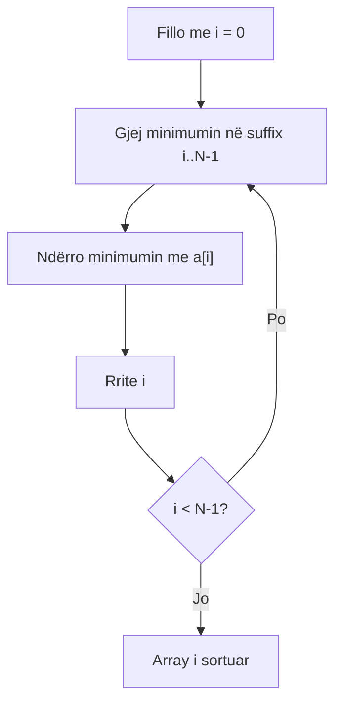
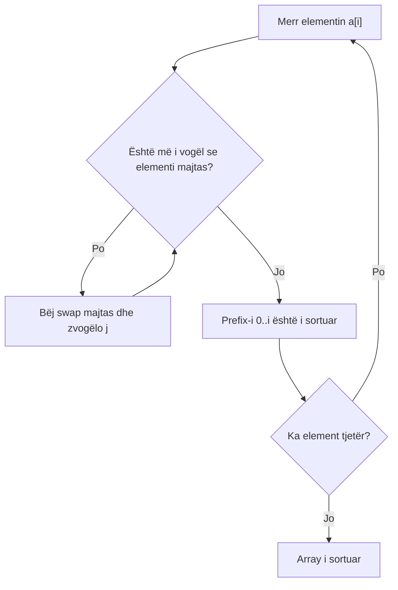
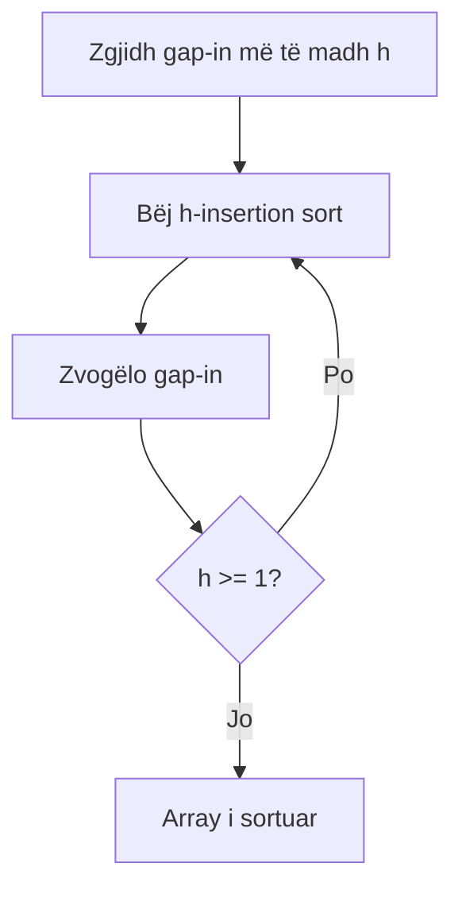

# 04 - Elementary Sorts

## Hape burimin dhe shiko demonstrimin

- [21ElementarySorts.pdf](../21ElementarySorts.pdf)
- [Elementary Sorts - Detyrat e shtepise.pdf](../Elementary%20Sorts%20-%20Detyrat%20e%20shtepise.pdf)
- [Elementary Sorts - Detyra të zgjidhura detyra për ushtrime.pdf](../Elementary%20Sorts%20-%20Detyra%20t%C3%AB%20zgjidhura%20detyra%20p%C3%ABr%20ushtrime.pdf)

**Demonstrimet falas të Princeton-it** (ndali te çdo hap, kopjo gjendjen në letër dhe krahasoje me trace-in e kësaj teme):

- [Selection Sort (.mov)](https://algs4.cs.princeton.edu/lectures/demo/21DemoSelectionSort.mov)
- [Insertion Sort (.mov)](https://algs4.cs.princeton.edu/lectures/demo/21DemoInsertionSort.mov)
- [Shellsort: h-sorting (.mov)](https://algs4.cs.princeton.edu/lectures/demo/21DemoShellSort.mov)

Skedarët `.mov` janë video të shkurtra demonstrimi; nëse browseri nuk i luan, hapini me një video player. Demonstrimi `PDF` hapet si dokument, nuk është video.

**Si të punosh:** provo vetë detyrën e punuar para se ta lexosh përgjigjen; bëj pastaj detyrën «për ty» dhe kontrollo [ushtrimet e plota me zgjidhje](18-PRAKTIKA-PARA-PROVIMIT.md).

## Burimet e mbuluara

- `21ElementarySorts.pdf`
- `Elementary Sorts - Detyrat e shtepise.pdf`
- `Elementary Sorts - Detyra të zgjidhura detyra për ushtrime.pdf`

## Comparable dhe operacionet ndihmëse

**Nga PDF-ja e zgjidhjeve:** [Selection me inputin `[14,32,2,59,15,35,29,98]`, çdo minimum dhe ndërrim](20-DETYRA-ORIGJINALE-TE-ZGJIDHURA.md#1-selection-sort-detyra-1-e-pdf-së). Për Insertion dhe Shell përdor figurat dhe inputet e [të njëjtit PDF](../Elementary%20Sorts%20-%20Detyra%20t%C3%AB%20zgjidhura%20detyra%20p%C3%ABr%20ushtrime.pdf); kontrollo vargun pas çdo `i` dhe pas çdo `h`.

`v.compareTo(w)` kthen negativ, zero ose pozitiv. Algoritmet përdorin:

```java
less(v, w)  // v < w
exch(a, i, j)
```

Për tipe të personalizuara, `compareTo` duhet të krijojë total order.

## Selection sort

Në iterimin `i`, gjen minimumin në `[i..N-1]` dhe e ndërron me `a[i]`.

```java
public static void sort(Comparable[] a) {
    int N = a.length;
    for (int i = 0; i < N; i++) {
        int min = i;
        for (int j = i+1; j < N; j++)
            if (less(a[j], a[min])) min = j;
        exch(a, i, min);
    }
}
```

Kjo është rrjedha e kodit për `Comparable[]` në `21ElementarySorts.pdf`; `less(v,w)` do të thotë `v.compareTo(w)<0`, ndërsa `exch(a,i,j)` i ndërron dy elementet. Shprehja `a[j] < a[min]` punon për `int[]`, por **jo** për objekte `Comparable` në Java.

Invariant: `[0..i-1]` është i sortuar dhe final; asnjë element në të djathtë nuk është më i vogël se ai prefix.

- Krahasime: `N(N-1)/2`.
- Ndërrime: afërsisht `N`.
- Best/average/worst: `O(N²)`.
- In-place; zakonisht jo stable.

Avantazh: pak ndërrime, i dobishëm kur lëvizja e elementit kushton shumë.

## Insertion sort

Prefix-i majtas mbahet i sortuar. Elementi aktual lëviz majtas derisa të arrijë vendin.

```java
public static void sort(Comparable[] a) {
    int N = a.length;
    for (int i = 0; i < N; i++)
        for (int j = i; j > 0; j--)
            if (less(a[j], a[j-1])) exch(a, j, j-1);
            else break;
}
```

Invariant: `[0..i]` është i sortuar pas iterimit `i`.

- Best: `N-1` krahasime, 0 swaps -> `O(N)`.
- Average: rreth `N²/4` krahasime/swaps.
- Worst: rreth `N²/2` -> `O(N²)`.
- In-place dhe stable, nëse elementet e barabarta nuk ndërrohen.

Shumë i mirë për array të vogla ose pothuajse të sortuara.

## Shellsort

Është insertion sort me hapa `h`. Fillimisht lëviz elementet larg, pastaj përfundon me `h=1`.

Sekuenca 3x+1: `1, 4, 13, 40, ...`. Nise `h=1`; derisa `h < N/3`, përditësoje `h=3h+1`. Pastaj, pas çdo faze, përdor `h=h/3` deri te `h=1`. Për shembull, me `N=10` fazat janë `h=4` dhe `h=1`.

```java
public static void sort(Comparable[] a) {
    int N = a.length;
    int h = 1;
    while (h < N/3) h = 3*h + 1;
    while (h >= 1) {
        for (int i = h; i < N; i++)
            for (int j = i; j >= h && less(a[j], a[j-h]); j -= h)
                exch(a, j, j-h);
        h = h/3;
    }
}
```

`h`-sorted do të thotë se çdo nënsekuencë `a[r], a[r+h], a[r+2h]...` është e sortuar. Pas `h=1`, array është plotësisht e sortuar.

- In-place, jo stable.
- Materiali jep worst rreth `N^(3/2)` për 3x+1; analiza e saktë varet nga gap sequence.

## Shembuj të zgjidhur hap pas hapi

### Selection sort

Sorto `[6, 3, 5, 1]`. Në çdo iterim kërkohet minimumi i suffix-it dhe bëhet vetëm një swap.

| `i` | Suffix-i i skanuar | Minimumi | Array pas swap-it |
|---:|---|---:|---|
| 0 | `[6, 3, 5, 1]` | 1 | `[1, 3, 5, 6]` |
| 1 | `[3, 5, 6]` | 3 | `[1, 3, 5, 6]` |
| 2 | `[5, 6]` | 5 | `[1, 3, 5, 6]` |

Pas iterimit të parë, `1` është në pozitën finale; algoritmi nuk ndalet edhe pse pjesa tjetër rastësisht është e sortuar.

#### Detyrë për ty

Apliko selection sort në `[9, 4, 7, 2, 6]`. Shkruaj `i`, indeksin e minimumit dhe array-in pas çdo swap-i.

### Insertion sort

Sorto `[5, 2, 4, 3]` duke futur elementin aktual në prefix-in e sortuar:

1. `i=1`: `2 < 5`, ndërroji -> `[2, 5, 4, 3]`.
2. `i=2`: `4 < 5`, ndërroji -> `[2, 4, 5, 3]`; `4 < 2` është false, ndalo.
3. `i=3`: `3 < 5` -> `[2, 4, 3, 5]`; `3 < 4` -> `[2, 3, 4, 5]`; `3 < 2` është false.

Prefix-i zmadhohet nga një element pas çdo iterimi dhe mbetet i sortuar.

#### Detyrë për ty

Apliko insertion sort në shkronjat `A L G O`. Shkruaj array-in pas çdo swap-i dhe rretho prefix-in e sortuar pas çdo `i`.

### Shellsort

Sorto `[8, 5, 3, 7, 6, 2]` me gap-et `h=4`, pastaj `h=1`.

- Me `h=4`, krahasohen indekset `(0,4)` dhe `(1,5)`: `6 < 8` jep `[6,5,3,7,8,2]`; `2 < 5` jep `[6,2,3,7,8,5]`.
- Me `h=1`, vazhdohet insertion sort. Shkruaj çdo **swap**: `[6,2,3,7,8,5]` -> `[2,6,3,7,8,5]` -> `[2,3,6,7,8,5]` -> `[2,3,6,7,5,8]` -> `[2,3,6,5,7,8]` -> `[2,3,5,6,7,8]`. Në `i=3` dhe `i=4` nuk ka swap; në `i=5` elementi `5` lëviz tri herë majtas.

Rezultati final është `[2, 3, 5, 6, 7, 8]`. Te `h=4` nuk krahasohen fqinjët, por elementet katër pozita larg.

#### Detyrë për ty

Apliko Shellsort me gap-et `4` dhe `1` në `[12, 7, 9, 1, 5, 3, 10, 2]`. Shkruaj array-in pas fazës `h=4`, pastaj pas çdo lëvizjeje të fazës `h=1`.

## Trace i saktë në provim

### Selection

Shëno `i`, skano për `min`, bëj vetëm një swap në fund të iterimit.

### Insertion

Pas çdo iterimi shkruaj prefix-in e sortuar. Elementi mund të bëjë disa swaps majtas.

### Shell

1. Gjej gap-et, p.sh. për `N=10`: `h=4`, pastaj `h=1`.
2. Për çdo `i`, krahaso vetëm me `i-h`, `i-2h`, ...
3. Shkruaj array pas çdo ndryshimi.

## Flow vizual i algoritmeve

Këto flow-e tregojnë **çka ndodh me array-n**. Blloqet e kodit më sipër janë versione të shkurtra për ta kuptuar rrjedhën; kur kërkohet sintaksa ose kodi identik, hap PDF-në origjinale të kursit më poshtë.

### Flow i Selection Sort



Në letër: për çdo rresht shkruaj `i`, suffix-in, minimumin dhe array-n pas swap-it.

### Flow i Insertion Sort



Në letër: rretho prefix-in e sortuar pas çdo `i` dhe shkruaj çdo lëvizje majtas.

### Flow i Shellsort



Në letër: ndaje punën në faza `h=...`; brenda fazës krahaso vetëm pozitat që janë `h` larg.

## Stable dhe in-place

- Stable: elementet me çelës të njëjtë ruajnë rendin relativ.
- In-place: përdor vetëm hapësirë shtesë konstante ose shumë të vogël.

Selection mund të lëvizë një element të barabartë përtej tjetrit; Shell bën swaps të largëta. Insertion lëviz vetëm kur është rreptësisht më i vogël, prandaj është stable.

## Gabimet tipike

- Gabim: bën swap sa herë gjen një minimum më të vogël gjatë skanimit. Në Selection gjen indeksin e minimumit dhe bën vetëm një swap **pas** skanimit të gjithë suffix-it.
- Insertion krahasohet me `a[i]` origjinal pa përcjellë lëvizjen e `j`.
- Shellsort harron gap-in `1`.
- Shkruan se selection ka best `O(N)` vetëm pse array është e sortuar; ai prapë skanon gjithçka.

## Krahasimi

| Algoritmi | Best | Average | Worst | Stable | In-place |
|---|---:|---:|---:|---|---|
| Selection | `N²` | `N²` | `N²` | Jo | Po |
| Insertion | `N` | `N²` | `N²` | Po | Po |
| Shell (3x+1) | më mirë se quadratic në praktikë | varet | rreth `N^(3/2)` në material | Jo | Po |

## Kontrolli i njohurive

1. Cili invariant përdoret nga selection sort?
2. Pse insertion sort është linear në array të sortuar?
3. Çka do të thotë 4-sorted?
4. Cili algoritëm bën numër minimal linear swaps?

## Ushtrime

- Selection: `13 24 15 8 25 19 4 1 4 46`.
- Insertion: `E L E M E N T A R Y`.
- Shellsort: `H A S H T A B L E S` me gap-et 4 dhe 1.
