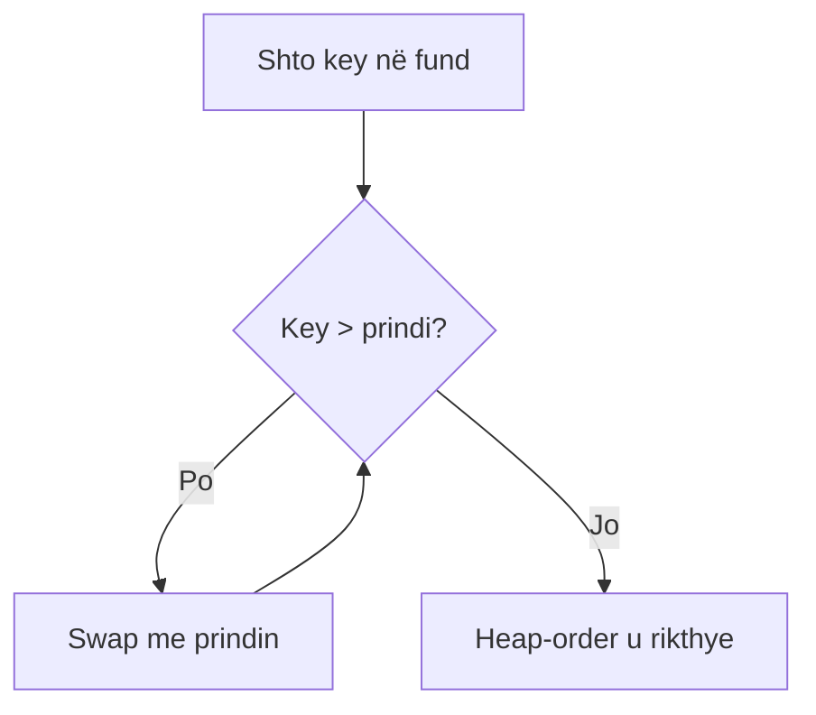
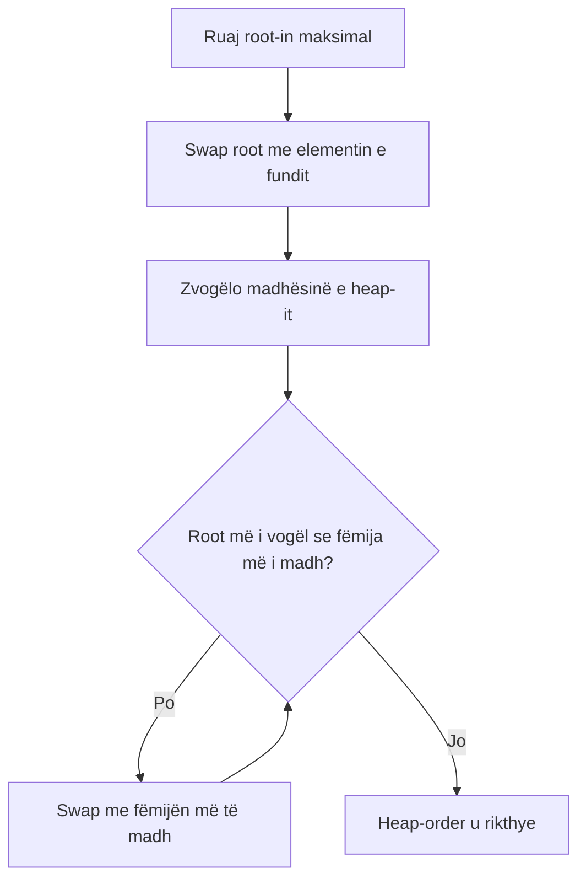
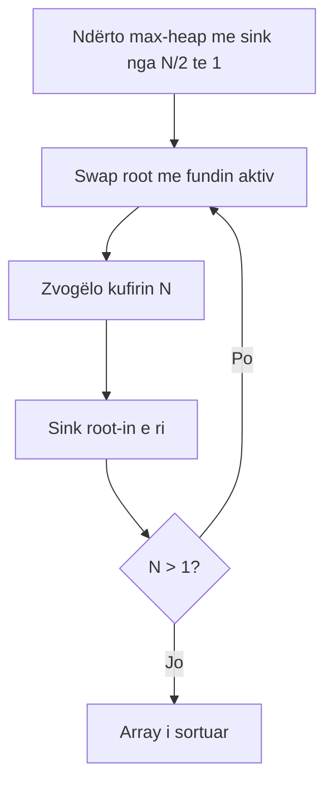

# 07 - Priority Queues dhe Heapsort

## Burimet e mbuluara

- `24PriorityQueues.pdf`
- `HeapSort - Detyra të zgjidhura.docx`
- `HeapSort - Detyrat e shtëpisë.docx`

## Priority Queue

Max-PQ ruan elemente dhe gjithmonë largon maksimumin. API tipike: `insert`, `max`, `delMax`, `isEmpty`, `size`.

| Implementimi | insert | max | delMax |
|---|---:|---:|---:|
| array i pasortuar | `O(1)` | `O(N)` | `O(N)` |
| array i sortuar | `O(N)` | `O(1)` | `O(1)` |
| binary heap | `O(log N)` | `O(1)` | `O(log N)` |

## Complete binary tree

Të gjitha nivelet janë të plota përveç të fundit; niveli i fundit mbushet majtas-djathtas. Lartësia është `floor(log2 N)`.

Në array me indeksim nga 1:

- prindi i `k`: `k/2`;
- fëmija majtas: `2k`;
- fëmija djathtas: `2k+1`.

Në max-heap, çdo prind është `>=` fëmijët. Vetëm root është patjetër maksimumi; array nuk është plotësisht i sortuar.

## Swim

Pas insertimit në fund, nëse elementi është më i madh se prindi, ndërroji dhe vazhdo lart.

```java
while (k>1 && less(k/2,k)) {
    exch(k,k/2);
    k=k/2;
}
```

Kosto `O(log N)`.

## Sink

Pas `delMax` ose gjatë heap construction, një nyje mund të jetë më e vogël se fëmijët. Zgjidh fëmijën më të madh dhe ndërro nëse është e nevojshme.

```java
while (2*k<=N) {
    int j=2*k;
    if (j<N && less(j,j+1)) j++;
    if (!less(k,j)) break;
    exch(k,j);
    k=j;
}
```

Duhet fëmija më i madh; zgjedhja e më të voglit mund ta lërë heap-order të shkelur.

## Insert dhe delMax

Insert:

1. `pq[++N]=x`;
2. `swim(N)`.

delMax:

1. ruaj `pq[1]`;
2. swap root me `pq[N]`, zvogëlo `N`;
3. `sink(1)`;
4. vendos slotin e vjetër `null`;
5. kthe maksimumin.

## Shembuj të zgjidhur hap pas hapi

Array-t më poshtë janë max-heaps me indeksim nga 1.

### Insert dhe swim

Fillo me `[8,6,7,3,2,5]` dhe inserto `9`.

1. Shto `9` në fund, në indeksin 7: `[8,6,7,3,2,5,9]`.
2. Prindi është në `7/2=3`, me vlerë `7`. Meqë `9>7`, swap -> `[8,6,9,3,2,5,7]`.
3. Tani `9` është në indeksin 3; prindi është indeksi 1 me vlerë `8`. Swap -> `[9,6,8,3,2,5,7]`.
4. Elementi arriti root-in; heap-order është rikthyer.

#### Detyrë për ty

Inserto `10` në heap-in `[9,7,8,3,2,5,6]`. Shëno indeksin, prindin dhe array-in pas çdo swap-i.

### delMax dhe sink

Fillo me `[9,6,8,3,2,5,7]`.

1. Ruaj maksimumin `9`; ndërro root me elementin e fundit dhe zvogëlo heap-in: `[7,6,8,3,2,5]`.
2. Fëmijët e root-it janë `6` dhe `8`; zgjidhet më i madhi, `8`.
3. `7<8`, prandaj swap -> `[8,6,7,3,2,5]`.
4. `7` në indeksin 3 ka vetëm fëmijën `5` dhe nuk është më i vogël; sink ndalet.

Rezultati i kthyer është `9`, ndërsa heap-i i mbetur është `[8,6,7,3,2,5]`.

#### Detyrë për ty

Ekzekuto `delMax` në `[15,11,13,7,9,4,8,2]`. Shëno cili fëmijë zgjidhet në çdo sink dhe pse. Pastaj verifiko që çdo prind në heap-in final është `>=` fëmijët.

## Heapsort

### Faza 1: heap construction

Trajto array si complete tree dhe bëj `sink` nga `N/2` deri te 1. Gjethet nuk kanë nevojë për sink.

```java
for (int k=N/2; k>=1; k--) sink(a,k,N);
```

Kjo fazë është `O(N)`, jo `O(N log N)`; shumica e nyjeve janë afër fundit dhe zhyten pak.

### Faza 2: sortdown

```java
while (N>1) {
    exch(a,1,N--);
    sink(a,1,N);
}
```

Maksimumi kalon në fund dhe përjashtohet nga heap-i aktiv. Prefix-i mbetet heap, suffix-i rritet i sortuar.

## Veti

- Kohë `O(N log N)` worst case.
- In-place.
- Jo stable.
- Nuk ka nevojë për randomization dhe ka garanci të fortë, por shpesh është më i ngadalshëm në praktikë se quicksort për shkak të cache locality.

## Trace në provim

1. Vizato indekset nga 1.
2. Gjatë construction shëno `k=N/2...1` dhe array pas çdo `sink`.
3. Gjatë sortdown shëno kufirin `N`; pjesa djathtas është final.
4. Për insert/delMax vizato tree dhe array paralelisht.

## Flow vizual i heap-it

### Insert dhe swim



### delMax dhe sink



### Heapsort i plotë



Në çdo rresht të zgjidhjes shkruaj array-n, indeksin aktiv, prindin/fëmijët dhe arsyen e swap-it. Kështu merren pikë edhe nëse gabon një llogaritje më vonë.

## Shembull conceptual

Për `A={13,2,27,68,45,72,81,99}`:

- ndërto max-heap me bottom-up sink;
- shto 74 në fund dhe `swim`;
- `delMax` heq root 99, sjell të fundit në root dhe bën `sink`;
- sortdown vendos maksimumet nga fundi drejt fillimit.

Mos e ndërto heap-in duke sortuar array-n paraprakisht; kjo e humb qëllimin e algoritmit.

## Gabimet tipike

- Ngatërron max-heap me BST; heap nuk garanton rend mes subtrees.
- Përdor indekset e formulës 1-based në array 0-based pa përshtatje.
- Në `sink` zgjedh fëmijën e vogël.
- Gjatë sortdown e përfshin prapë suffix-in e sortuar.
- Thotë se heap construction është `N log N` si kufi i ngushtë.

## Kontrolli i njohurive

1. Pse `max()` është `O(1)`?
2. Kur përdoret `swim` dhe kur `sink`?
3. Pse cikli i construction fillon në `N/2`?
4. Cili është invarianti gjatë sortdown?

## Ushtrime

- HeapSort: `7 21 2 29 54 67 12 75 87 14 4 89`.
- Ndërto heap, insert 91, delMax dhe sorto: `26 43 8 24 32 83 68 90 38 62`.
- HeapSort: `E X P L O R A T I O N`.
