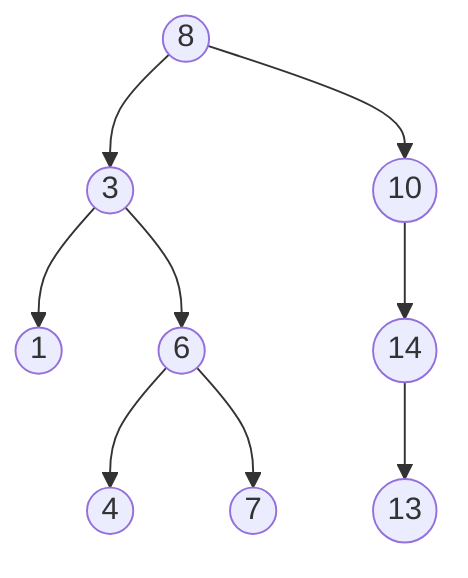

# 09 - Binary Search Trees (BST)

## Hape burimin dhe shiko demonstrimin

- [32BinarySearchTrees.pdf](../32BinarySearchTrees.pdf)
- [BST - Detyrat e shtëpisë .pdf](../BST%20-%20Detyrat%20e%20sht%C3%ABpis%C3%AB%20.pdf)
- [BST - Detyra të zgjidhura.pdf](../BST%20-%20Detyra%20t%C3%AB%20zgjidhura.pdf)

**Demonstrimet falas të Princeton-it** (ndali te çdo hap, kopjo gjendjen në letër dhe krahasoje me trace-in e kësaj teme):

- [Ndërtimi i BST (.mov)](https://algs4.cs.princeton.edu/lectures/demo/32DemoBinarySearchTree.mov)

Skedarët `.mov` janë video të shkurtra demonstrimi; nëse browseri nuk i luan, hapini me një video player. Demonstrimi `PDF` hapet si dokument, nuk është video.

**Si të punosh:** provo vetë detyrën e punuar para se ta lexosh përgjigjen; bëj pastaj detyrën «për ty» dhe kontrollo [ushtrimet e plota me zgjidhje](18-PRAKTIKA-PARA-PROVIMIT.md).

## Burimet e mbuluara

- `32BinarySearchTrees.pdf`
- `BST - Detyrat e shtëpisë .pdf`
- `BST - Detyra të zgjidhura.pdf`

## Rregulla e BST

**Nga PDF-ja e zgjidhjeve:** [fshirja e 62 dhe `floor(68)` para/pas, me vizatimin përkatës](20-DETYRA-ORIGJINALE-TE-ZGJIDHURA.md#4-bst-detyra-1-e-pdf-së-para-dhe-pas-fshirjes).

Për çdo node me key `k`:

- të gjithë keys në subtree majtas janë `< k`;
- të gjithë keys në subtree djathtas janë `> k`.

Node ruan `key`, `value`, `left`, `right` dhe, kur duhet rank/select, `count` të subtree.

Forma varet nga rendi i insertimit. I njëjti set mund të prodhojë tree të balancuar ose një listë të pjerrët.

## Search (`get`)

Fillo në root: key më i vogël -> majtas; më i madh -> djathtas; baraz -> gjetur. Kostoja është `O(h)`, ku `h` është lartësia.

## Insert (`put`)

Search deri te një null link dhe krijo node. Nëse key ekziston, update value.

```java
Node put(Node x, Key key, Value val) {
    if (x==null) return new Node(key,val,1);
    int cmp=key.compareTo(x.key);
    if (cmp<0) x.left=put(x.left,key,val);
    else if (cmp>0) x.right=put(x.right,key,val);
    else x.val=val;
    x.count=1+size(x.left)+size(x.right);
    return x;
}
```

Kthimi i `x` rivendos linkat gjatë kthimit nga rekursioni.

## Lartësia dhe performanca

- Best/balancuar: `h = Theta(log N)`.
- Average për rend random: rreth `1.39 log2 N` krahasime në material.
- Worst për keys të insertuar të sortuar: `h=N-1`, operacionet `O(N)`.

## Min, max, floor, ceiling

- `min`: ec majtas deri sa `left==null`.
- `max`: ec djathtas.
- `floor(k)`: key më i madh `<=k`.
- `ceiling(k)`: key më i vogël `>=k`.

Për floor:

- nëse `k == x.key`, përgjigjja është `x`;
- nëse `k < x.key`, kërko majtas;
- nëse `k > x.key`, provo djathtas; nëse s'ka rezultat, `x` është floor.

## Traversals

| Traversal | Rendi | Përdorimi |
|---|---|---|
| Preorder | Root, Left, Right (`VLR`) | serializim/konstruktim |
| Inorder | Left, Root, Right (`LVR`) | keys në rend rritës në BST |
| Postorder | Left, Right, Root (`LRV`) | fshirje/evaluim bottom-up |

Vërejtje: një fjali në slide thotë gabimisht se inorder jep nga më i madhi te më i vogli; me `left-root-right` rezultati standard është nga më i vogli te më i madhi.

## Rank dhe select

Nëse çdo node mban `count`:

- `rank(k)` përdor madhësinë e subtree majtas;
- `select(r)` gjen node që ka saktësisht `r` keys më të vegjël.

Counts duhet të përditësohen pas insert/delete.

## Delete minimum

Ec majtas. Kur `x.left==null`, kthe `x.right`; pastaj përditëso links dhe count gjatë kthimit.

## Hibbard delete

Pasi gjendet node `x`:

1. Pa fëmijë: kthe `null`.
2. Vetëm një fëmijë: kthe atë fëmijë.
3. Dy fëmijë: zëvendëso me successor-in, minimumin e subtree djathtas; lidhe me `deleteMin(old.right)` dhe me subtree majtas.

```java
Node t=x;
x=min(t.right);
x.right=deleteMin(t.right);
x.left=t.left;
```

Mund të përdoret edhe predecessor-i (max i majtë), por zgjidh një metodë dhe ndiqe konsistent.

## Ndërtimi nga traversals

- Preorder: elementi i parë është root.
- Postorder: elementi i fundit është root.
- Inorder ndan qartë subtree majtas/djathtas.

Preorder + inorder ose postorder + inorder japin tree unik kur keys janë unikë. Vetëm preorder + postorder zakonisht nuk mjaftojnë për binary tree arbitrar; për BST, vetia e rendit ndihmon ta rindërtosh.

## Shembull pune

Për `24,22,94,19,62,39,88,32,40,41,27`:

- 24 root; 22 majtas; 94 djathtas; 19 majtas të 22; 62 majtas të 94; etj.
- Për të fshirë 62 me successor, përdor minimumin e subtree të tij djathtas (88 në strukturën e dhënë).
- `floor(68)=62` **para** fshirjes së 62. Nëse zëvendëson 62 me predecessor-in 41, **pas** fshirjes `floor(68)=41`; pas futjes së 90 vlera mbetet 41. PDF-ja shënon 41 te pema e modifikuar. Gjithmonë shëno gjendjen kohore të pemës në zgjidhje.

## Shembull i zgjidhur hap pas hapi

Inserto `8,3,10,1,6,14,4,7,13` në këtë rend:

- `8` bëhet root.
- `3<8`, prandaj shkon majtas; `10>8`, prandaj djathtas.
- Për `6`: `6<8`, pastaj `6>3`, kështu bëhet fëmijë djathtas i 3.
- Për `4`: `4<8`, `4>3`, `4<6`, kështu bëhet fëmijë majtas i 6.
- Çdo key tjetër vendoset duke e nisur krahasimin përsëri nga root-i.



Traversals dalin duke zbatuar rregullin në çdo subtree, jo duke lexuar vetëm diagramin horizontalisht:

- inorder: `1,3,4,6,7,8,10,13,14`;
- preorder: `8,3,1,6,4,7,10,14,13`;
- postorder: `1,4,7,6,3,13,14,10,8`.

Për key që mungon `5`, rruga e kërkimit është `8 -> 3 -> 6 -> 4 -> null`. Gjatë kësaj rruge, kandidati më i mirë më i vogël është `4`, ndërsa më i madhi është `6`; pra `floor(5)=4`, `ceiling(5)=6`.

Për të fshirë `3`, i cili ka dy fëmijë, successor-i është minimumi i subtree djathtas: `4`. `4` zë vendin e `3`, hiqet nga pozita e vjetër dhe mban majtas `1`, djathtas subtree me root `6`.

### Detyrë për ty

Ndërto BST për `12,5,18,2,9,15,19,7,10`. Shkruaj tri traversals, gjej `floor(8)` dhe `ceiling(8)`, pastaj fshi `5` duke përdorur successor-in. Vizato tree para dhe pas fshirjes dhe kontrollo që inorder mbetet i sortuar.

## Gabimet tipike

- Vendos key duke e krahasuar vetëm me prindin e fundit, jo nga root përgjatë rrugës.
- Inorder shkruhet root-left-right.
- Fshin node me dy fëmijë pa hequr successor-in nga pozita e vjetër.
- Nuk update `count`.
- `floor` kthen gjithmonë prindin e fundit pa verifikuar subtree djathtas.

## Kontrolli i njohurive

1. Pse worst case i BST është `O(N)`?
2. Cili traversal jep keys të sortuar?
3. Si fshihet node me dy fëmijë?
4. Dallimi mes successor dhe predecessor?

## Ushtrime

- Ndërto dhe modifiko BST për `8,3,10,1,6,14,4,7`; fshi 3, shto 5, bëj tri traversals.
- Rindërto nga inorder/postorder të PDF-së dhe shkruaj preorder.
- Për disa keys që ekzistojnë dhe mungojnë, gjej `get`, `floor`, `ceiling`.
