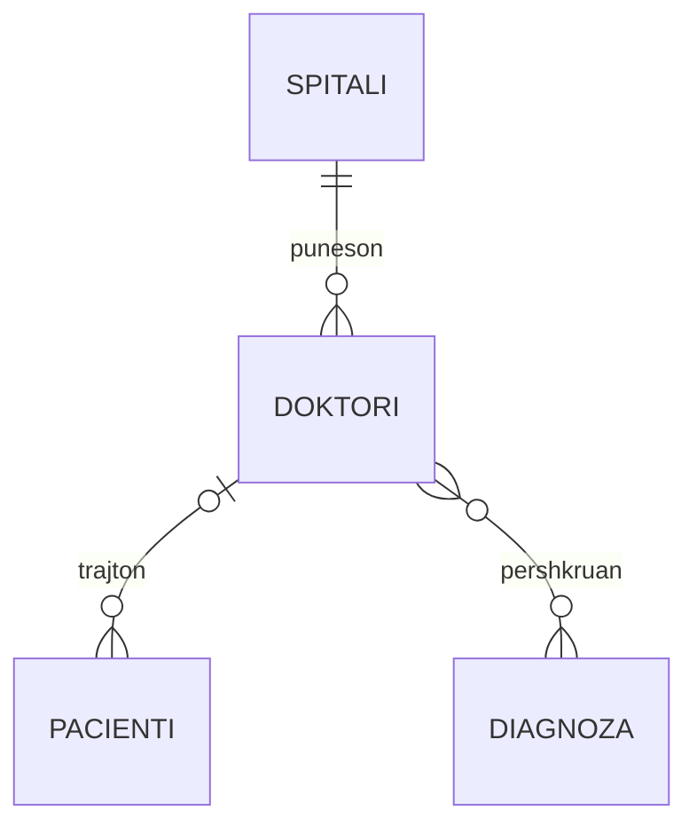

# 01 — Prej kërkesës te ERD/EERD

Burimi: ligjëratat [1](../03%20-%20Ligjërata%201/L1%20-%20Hyrje%20në%20Konceptet%20e%20Bazës%20së%20të%20Dhënave.pdf), [2](../04%20-%20Ligjërata%202/L2%20-%20Paraqitje%20e%20Modeleve%20të%20të%20Dhënave.pdf), [4](../06%20-%20Ligjërata%204/L4%20-%20Modeli%20Konceptual%20%28ERD%20-%20Diagrami%20i%20Relacioneve%20të%20Entitetit%29.pdf), [5](../07%20-%20Ligjërata%205/L5%20-%20Modeli%20i%20Zgjeruar%20Konceptual%20%28EERD%20-%20Diagrami%20i%20Zgjeruar%20i%20Relacioneve%20të%20Entitetit%29.pdf). Nëse një lidhje PDF nuk hapet nga lexuesi yt Markdown, hape prej [README origjinal](../README.md).

## 1. Pse bazë e të dhënave?

Baza e të dhënave është koleksion i organizuar të dhënash. **DBMS** është softueri që i ruan, i pyet dhe kontrollon (p.sh. SQL Server). Aplikacioni i bën kërkesë DBMS-së; DBMS e zbaton mbi tabelat. Pa ndarje të qartë, të njëjtin emër doktori mund ta përsërisësh te çdo pacient dhe, kur doktori ndryshon mbiemrin, të mbesin të dhëna kontradiktore.

**Skema** është plani i tabelave/kolonave/lidhjeve; **instanca** janë rreshtat konkretë tani. Skema `Pacienti(Id, Emri, DoktoriId)` mbetet e njëjtë edhe kur shton një pacient.

Tre hapa projektimi:

1. **Konceptual:** Çfarë entitetesh, atributesh e marrëdhëniesh ka bota? ERD, pa vendosur tipe SQL.
2. **Logjik:** Si bëhen entitetet tabela, cilat kolona janë PK/FK? I pavarur nga detajet fizike.
3. **Fizik:** Tipet `INT`, `VARCHAR`, `DATE`, `CREATE TABLE`, indekse, kufizime në SQL Server.

## 2. Si lexon një kërkesë

Shembull: “Një spital punëson shumë doktorë. Çdo doktor punon në një spital. Pacienti mund të ketë një doktor dhe një doktor mund të trajtojë shumë pacientë. Doktorët mund të përshkruajnë shumë diagnoza dhe e njëjta diagnozë mund të përshkruhet nga shumë doktorë.”

- **Emrat kryesorë** → kandidatë entitetesh: Spitali, Doktori, Pacienti, Diagnoza.
- **Vetitë** → atribute: `Spitali.Emri`, `Doktori.PagaMujore`, `Pacienti.Datelindja`.
- **Foljet** → marrëdhënie: punëson, trajton, përshkruan.
- **Fjalët “një/shumë/mund/duhet”** → maksimumi dhe minimumi i lidhjes.
- Jep secilit entitet një identifikues stabil: `Spitali.Id`, jo emrin, nëse emri mund të përsëritet ose ndryshojë.

Në diagram, leximi i lidhjes mund të ndryshojë sipas drejtimit; lexo gjithmonë kërkesën me fjalë. Te pacienti me doktor opsional: **një pacient ka zero ose një doktor**, një doktor ka zero ose shumë pacientë. Nëse kërkesa thotë “çdo pacient patjetër ka doktor”, minimumi bëhet një.

## 3. Entiteti, atributi, çelësi

- **Entitet**: lloj objekti, p.sh. `Doktori`; instanca: doktori me ID 7.
- **Atribut i thjeshtë**: Paga. **I përbërë**: Adresa = rruga + qyteti; zakonisht ruaji pjesët veç.
- **Shumëvlerësh**: disa numra telefoni për person → tabelë e veçantë `Telefoni(PersonId, Numri)`, jo lista “049..., 044...” në një qelizë.
- **I derivuar**: mosha nga data e lindjes; llogaritet nga data aktuale. `DATEDIFF(YEAR, Datelindja, GETDATE())` jep diferencën e viteve kalendarike dhe mund ta mbivlerësojë moshën para ditëlindjes.
- **PK (primary key)**: identifikon çdo rresht, unik dhe jo NULL. **FK**: vlerë që referon PK/UNIQUE në tabelë tjetër (ose NULL nëse lidhja lejohet opsionale).
- **Çelës kandidat**: secila zgjedhje minimale unike; njëri zgjidhet PK. **Çelës i përbërë**: disa kolona së bashku identifikojnë rreshtin, p.sh. `(StudentId, LendaId)`.

## 4. Kardinaliteti dhe pjesëmarrja

| Marrëdhënia | Pyetja që bën | Zakonisht realizohet |
| --- | --- | --- |
| 1:1 | A mund të ketë një person dy karta? | FK UNIQUE në njërën tabelë; NOT NULL kur është e detyrueshme. |
| 1:N | Sa doktorë punojnë në një spital? Sa spitale ka një doktor? | FK `SpitaliId` te **Doktori**, ana “shumë”. |
| M:N | Sa lëndë ndjek studenti? Sa studentë ka lënda? | Tabelë ndërmjetëse `Regjistrim(StudentId,LendaId)`. |

**Pjesëmarrje e plotë**: çdo instancë merr pjesë (doktorit i duhet një spital → FK NOT NULL); **e pjesshme**: mund të mos marrë pjesë (pacienti ende pa doktor → FK NULL). Kujdes: NOT NULL në anën fëmijë nuk garanton vetvetiu që çdo prind ka të paktën një fëmijë.

**Entitet i dobët:** `RreshtPorosie` identifikohet brenda `Porosia` me `NrRreshtit`; PK është `(PorosiaId, NrRreshtit)`. Rreshti s'ka kuptim pa porosinë e vet; lidhje identifikuese.

## 5. EERD: trashëgimia

`Personi(Id, Emri)` mund të ketë nëntipe `Studenti(Id, Programi)` dhe `Profesori(Id, Titulli)`. **IS-A**: çdo student është person dhe trashëgon Id/Emri. **Specializimi** niset nga Personi e zbret te nëntipet; **gjeneralizimi** nis nga nëntipet dhe gjen tipin e përbashkët.

- **Disjoint**: një person mund të jetë vetëm në njërin nëntip.
- **Overlapping**: mund të jetë student dhe profesor njëkohësisht.
- **Total**: çdo person duhet të jetë së paku në një nëntip.
- **Partial**: lejohet person që s'është as student, as profesor.

Këto janë dy pyetje të pavarura: disjoint/overlap pyet “a mund të jetë në dy?”, total/partial pyet “a duhet të jetë në një?”. Në modelin tabelar, varianti i qartë është një tabelë supertip dhe nga një tabelë nëntipi me PK që është edhe FK te supertipi; rregullat total/disjoint mund të kërkojnë kontroll shtesë nga aplikacioni/DB.

**Agregimi EER**: kur marrëdhënia mes dy entiteteve duhet të sillet si njësi për t'u lidhur me entitet të tretë. Shembull `PunonNe(Punetor, Projekt)` dhe `Menaxher` mbikëqyr *atë angazhim*, jo punëtorin ose projektin pa kontekst.

## Provo vetë para se të shohësh 02

1. Biblioteka: një autor ka shumë libra, një libër mund të ketë shumë autorë. Çfarë tabele shtesë duhet?
2. Një porosi ka disa rreshta me numër 1, 2, 3. Numri i rreshtit përsëritet në porosi të tjera. Cili është PK?
3. Çdo pacient mund të mos ketë doktor. Cila FK është NULL dhe në cilën tabelë?

Kontrolli

1. `Autor_Liber(AutorId, LiberId)`, PK e përbërë nga të dyja.
2. `(PorosiaId, NrRreshtit)`.
3. `Pacienti.DoktoriId` lejohet NULL; FK referon `Doktori.Id`.

