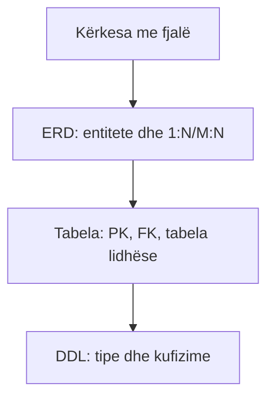

# 02 — ERD → tabela → CREATE TABLE

Burimi: ligjëratat 6–7, ushtrimet 6–7 dhe [shembulli DDL](../09%20-%20Ligjërata%207/Ushtrime_DDL.sql). Në kurs përdoret SQL Server, kështu që `IDENTITY`, `GO` dhe procedurat janë T-SQL.

## 1. Algoritmi i kthimit

1. Çdo entitet i fortë → një tabelë; atributet atomike → kolona; çelësi → PK.
2. Atribut i përbërë → ndaj në pjesë. Atribut shumëvlerësh → tabelë më vete me FK.
3. 1:N → PK e anës “një” bëhet FK te ana “shumë”. Vendos `NOT NULL` vetëm nëse pjesëmarrja është e detyrueshme.
4. 1:1 → FK + `UNIQUE`; vendos anën sipas opsionalitetit, ose bashko tabelat kur ka kuptim.
5. M:N → tabelë lidhëse me dy FK; PK shpesh `(FK1, FK2)`. Atributet e marrëdhënies (p.sh. `DataRegjistrimit`) shkojnë aty.
6. Entitet i dobët → FK te pronari dhe PK e përbërë me çelësin e pjesshëm.
7. Nëntip → tabelë supertip + tabelë nëntipi, PK e nëntipit është edhe FK te supertipi.



## 2. Shembull i plotë: dy tabela dhe M:N

Kërkesa: një doktor i përket një spitali; shumë doktorë mund të japin të njëjtën diagnozë.

```sql
CREATE TABLE Spitali (
    Id INT PRIMARY KEY,
    Emri VARCHAR(80) NOT NULL,
    Vendi VARCHAR(60) NOT NULL
);

CREATE TABLE Doktori (
    Id INT PRIMARY KEY,
    Emri VARCHAR(50) NOT NULL,
    SpitaliId INT NOT NULL,
    PagaMujore DECIMAL(9,2) CHECK (PagaMujore >= 0),
    CONSTRAINT FK_Doktori_Spitali
      FOREIGN KEY (SpitaliId) REFERENCES Spitali(Id)
);

CREATE TABLE Diagnoza (
    Id CHAR(5) PRIMARY KEY,
    Semundja VARCHAR(100) NOT NULL
);

CREATE TABLE Diagnoza_Doktori (
    DiagnozaId CHAR(5) NOT NULL,
    DoktoriId INT NOT NULL,
    DataPershkrimit DATE NULL,
    CONSTRAINT PK_Diagnoza_Doktori PRIMARY KEY (DiagnozaId, DoktoriId),
    CONSTRAINT FK_DD_Diagnoza FOREIGN KEY (DiagnozaId) REFERENCES Diagnoza(Id),
    CONSTRAINT FK_DD_Doktori FOREIGN KEY (DoktoriId) REFERENCES Doktori(Id)
);
```

Një rresht në `Diagnoza_Doktori` do të thotë *ky doktor ka këtë diagnozë*. PK e përbërë pengon duplikimin e të njëjtit çift; nëse kërkesa lejon shumë përshkrime në data të ndryshme, ndrysho PK (p.sh. shto `PershkrimId`), sepse çifti nuk është më unik. Së pari krijohen tabelat prind, pastaj fëmijët; për `INSERT` gjithashtu prind para fëmijës.

## 3. SQL që duhet ta dallosh

| Komanda | Ndryshon | A pranon WHERE? |
| --- | --- | --- |
| `CREATE TABLE` | krijon strukturë | jo |
| `ALTER TABLE ... ADD/DROP COLUMN` | strukturë ekzistuese | jo |
| `DROP TABLE` | heq tabelën/strukturën | jo |
| `TRUNCATE TABLE` | heq gjithë rreshtat, ruan strukturën | jo |
| `DELETE FROM ... WHERE` | heq rreshta të caktuar | po |
| `UPDATE ... SET ... WHERE` | ndryshon vlera të rreshtave | po |

```sql
ALTER TABLE Doktori ADD Email VARCHAR(120) NULL;
ALTER TABLE Doktori ADD CONSTRAINT UQ_Doktori_Email UNIQUE (Email);
-- Mos e ekzekuto pa e kuptuar ndikimin:
-- DELETE FROM Doktori WHERE Id = 7;
```

**Kufizimet:** `NOT NULL` kërkon vlerë; `UNIQUE` kufizon përsëritjen; `CHECK` kontrollon shprehjen; `DEFAULT` vendos vlerë kur kolona lihet jashtë INSERT; `PRIMARY KEY` garanton unike + jo NULL; `FOREIGN KEY` ruan integritetin referencial. `IDENTITY(1,1)` jep ID automatike në SQL Server: fillon me 1, rritet me 1. FK opsionale duhet të lejojë NULL, jo të referojë një ID që s'ekziston.

**ON DELETE CASCADE:** kur fshihet prindi, fshihen fëmijët. Vendose vetëm kur kërkesa e biznesit e lejon (p.sh. rreshtat e një porosie), jo automatikisht për histori pacientësh.

**Indeksi** ndihmon kërkimin/join sipas kolonës, por shton kosto shkrimi dhe hapësirë: `CREATE INDEX IX_Doktori_SpitaliId ON Doktori(SpitaliId);`. Është në rezultatet e të nxënit të syllabusit; pyetjet e kursit fokusohen sidomos te modelimi dhe queries.

## 4. Provo tani

Krijo `Studenti(Id, Emri)`, `Lenda(Id, Titulli)` dhe regjistrimin M:N me datë; studenti s'mund të regjistrohet dy herë në të njëjtën lëndë. Pa shikuar, shkruaj 3 CREATE TABLE.

<details><summary>Zgjidhja</summary>

```sql
CREATE TABLE Studenti (Id INT PRIMARY KEY, Emri VARCHAR(80) NOT NULL);
CREATE TABLE Lenda (Id INT PRIMARY KEY, Titulli VARCHAR(80) NOT NULL);
CREATE TABLE Regjistrimi (
  StudentId INT NOT NULL,
  LendaId INT NOT NULL,
  DataRegjistrimit DATE NOT NULL,
  PRIMARY KEY (StudentId, LendaId),
  FOREIGN KEY (StudentId) REFERENCES Studenti(Id),
  FOREIGN KEY (LendaId) REFERENCES Lenda(Id)
);
```

Nëse një student mund ta ndjekë lëndën përsëri në një semestër tjetër, PK duhet të përfshijë semestrin ose një `RegjistrimId`.
</details>
