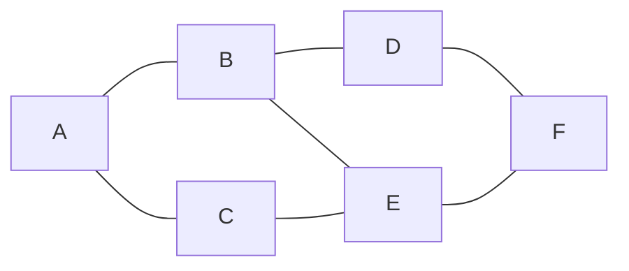
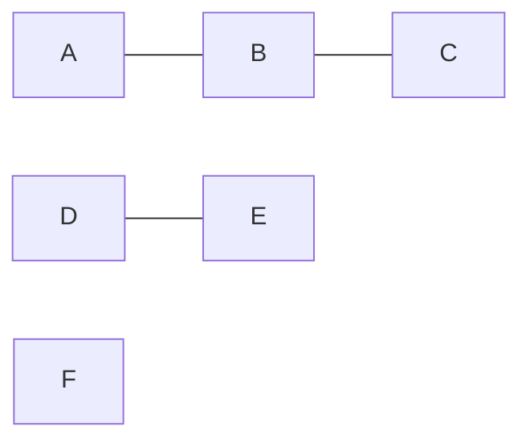

# 02 - Grafet pa drejtim: DFS, BFS dhe Connected Components

Video përkatëse: [Ligjërata 1](https://www.youtube.com/watch?v=Jxiu3MtsVgg) dhe [Ushtrimi 1](https://www.youtube.com/watch?v=jANLJngStwA).

## 1. Çka është grafi?

Grafi është model për objekte dhe lidhjet mes tyre.

- Objekti quhet **kulm** ose vertex.
- Lidhja quhet **brinjë** ose edge.
- Grafi shkruhet `G = (V, E)`.

Shembuj:

- personat janë kulme, miqësitë janë brinjë;
- qytetet janë kulme, rrugët janë brinjë;
- kompjuterët janë kulme, kabllot janë brinjë.

Në graf pa drejtim, brinja `A-B` lejon lëvizje nga A te B dhe nga B te A.



## 2. Termat bazë

### Kulme fqinje

A dhe B janë fqinj nëse ekziston brinja `A-B`.

### Shkalla - degree

`degree(v)` është numri i brinjëve që lidhen me `v`.

Në figurën sipër:

- `degree(A) = 2`;
- `degree(B) = 3`;
- `degree(E) = 3`.

### Rruga - path

Rruga është varg kulmesh ku çdo dy kulme të njëpasnjëshme kanë brinjë.

`A-B-E-F` është rrugë.

### Cikli - cycle

Cikli është rrugë që kthehet në kulmin fillestar pa përsëritur brinjë.

`A-B-E-C-A` është cikël.

### Graf i lidhur

Grafi është connected kur ekziston rrugë mes çdo çifti kulmesh.

## 3. Si ruhet grafi në memorie?

### Adjacency matrix

Për `V` kulme krijohet matricë `V x V`. Nëse ka brinjë `u-v`, vendoset `1` në `[u][v]` dhe `[v][u]`.

Për A-B, A-C dhe B-C:

|   | A | B | C |
|---|---:|---:|---:|
| A | 0 | 1 | 1 |
| B | 1 | 0 | 1 |
| C | 1 | 1 | 0 |

Avantazhi: kontrolli i brinjës bëhet në `O(1)`.

Mangësia: memoria është `O(V²)`, edhe nëse grafi ka pak brinjë.

### Adjacency list

Për çdo kulm ruhet lista e fqinjëve.

```text
A: B, C
B: A, C
C: A, B
```

Memoria është `O(V + E)`. Ky reprezentim përdoret zakonisht në DFS dhe BFS.

### Java - skeleti i grafit

```java
import java.util.ArrayList;
import java.util.List;

class Graph {
    private final int V;
    private int E;
    private final List<Integer>[] adj;

    @SuppressWarnings("unchecked")
    Graph(int V) {
        this.V = V;
        this.E = 0;
        adj = (List<Integer>[]) new List[V];
        for (int v = 0; v < V; v++) {
            adj[v] = new ArrayList<>();
        }
    }

    void addEdge(int v, int w) {
        adj[v].add(w);
        adj[w].add(v); // sepse grafi është pa drejtim
        E++;
    }

    Iterable<Integer> adj(int v) {
        return adj[v];
    }
}
```

## 4. DFS - Depth First Search

DFS do të thotë kërkim në thellësi. Algoritmi zgjedh një fqinj të pashënuar dhe vazhdon sa më thellë që mundet. Kur bllokohet, kthehet prapa.

### Strukturat që përdor

- `marked[v]`: `true` nëse `v` është vizituar;
- `edgeTo[v]`: prindi prej të cilit u zbulua `v`;
- stack ose rekursion.

### Pse duhet `marked[]`?

Pa `marked[]`, në brinjën A-B do të shkonim A->B->A->B pafund.

### Pseudokodi

```text
DFS(v):
    marked[v] = true

    për çdo w në adj[v]:
        nëse marked[w] është false:
            edgeTo[w] = v
            DFS(w)
```

### Java

```java
class DepthFirstSearch {
    private final boolean[] marked;
    private final int[] edgeTo;
    private final int source;

    DepthFirstSearch(Graph g, int source) {
        this.source = source;
        marked = new boolean[g.V()];
        edgeTo = new int[g.V()];
        dfs(g, source);
    }

    private void dfs(Graph g, int v) {
        marked[v] = true;

        for (int w : g.adj(v)) {
            if (!marked[w]) {
                edgeTo[w] = v;
                dfs(g, w);
            }
        }
    }
}
```

### Ekzekutimi hap pas hapi

Marrim graf:

```text
A: B, C
B: A, D, E
C: A, E
D: B, F
E: B, C, F
F: D, E
```

Fillo në A dhe përdor fqinjët në rend alfabetik.

| Hapi | Kulmi aktiv | Veprimi | Vizituar |
|---:|---|---|---|
| 1 | A | shëno A; shko te B | A |
| 2 | B | shëno B; A është marked; shko te D | A, B |
| 3 | D | shëno D; shko te F | A, B, D |
| 4 | F | shëno F; D është marked; shko te E | A, B, D, F |
| 5 | E | shëno E; B është marked; shko te C | A, B, D, F, E |
| 6 | C | shëno C; fqinjët janë marked | A, B, D, F, E, C |

Një rend DFS është `A, B, D, F, E, C`.

Rendi mund të ndryshojë nëse adjacency list ka rend tjetër. Kjo nuk e bën përgjigjen gabim, nëse çdo zgjedhje respekton listën e fqinjëve.

### Si rikonstruktohet rruga?

Nëse `edgeTo[B]=A`, `edgeTo[D]=B`, `edgeTo[F]=D`, rruga nga A te F rikonstruktohet mbrapsht:

```text
F <- D <- B <- A
```

Pastaj kthehet rendi: `A-B-D-F`.

### Kompleksiteti

Me adjacency list:

- koha: `O(V + E)`;
- memoria: `O(V)` për `marked`, `edgeTo` dhe stack-un.

## 5. BFS - Breadth First Search

BFS do të thotë kërkim në gjerësi. Viziton të gjithë fqinjët e burimit, pastaj fqinjët e tyre dhe kështu me radhë.

### Struktura që përdor

BFS përdor **queue**.

### Pseudokodi

```text
BFS(s):
    marked[s] = true
    enqueue(s)

    derisa queue nuk është bosh:
        v = dequeue()

        për çdo w në adj[v]:
            nëse marked[w] është false:
                marked[w] = true
                edgeTo[w] = v
                enqueue(w)
```

Vëreje: `marked[w] = true` bëhet para `enqueue(w)`. Nëse e shënojmë vetëm kur del nga queue, i njëjti kulm mund të futet disa herë.

### Java

```java
private void bfs(Graph g, int source) {
    Queue<Integer> queue = new ArrayDeque<>();

    marked[source] = true;
    queue.add(source);

    while (!queue.isEmpty()) {
        int v = queue.remove();

        for (int w : g.adj(v)) {
            if (!marked[w]) {
                marked[w] = true;
                edgeTo[w] = v;
                distTo[w] = distTo[v] + 1;
                queue.add(w);
            }
        }
    }
}
```

### Ekzekutimi në të njëjtin graf

| Hapi | Del nga queue | Fqinjët e rinj që futen | Queue pas hapit | Vizituar |
|---:|---|---|---|---|
| 0 | - | A | A | A |
| 1 | A | B, C | B, C | A, B, C |
| 2 | B | D, E | C, D, E | A, B, C, D, E |
| 3 | C | asnjë | D, E | A, B, C, D, E |
| 4 | D | F | E, F | A, B, C, D, E, F |
| 5 | E | asnjë | F | A, B, C, D, E, F |
| 6 | F | asnjë | bosh | A, B, C, D, E, F |

Rendi BFS është `A, B, C, D, E, F`.

### Pse BFS e jep shortest path pa peshë?

BFS i viziton kulmet sipas numrit të brinjëve nga burimi:

- niveli 0: burimi;
- niveli 1: kulmet një brinjë larg;
- niveli 2: kulmet dy brinjë larg.

Kur një kulm zbulohet për herë të parë, nuk mund të ekzistojë rrugë me më pak brinjë që ende nuk është shqyrtuar.

### Kompleksiteti

- koha: `O(V + E)`;
- memoria: `O(V)`.

## 6. DFS kundrejt BFS

| Pyetja | DFS | BFS |
|---|---|---|
| Struktura | Stack/rekursion | Queue |
| Sjellja | Shkon thellë | Shkon nivel pas niveli |
| Shortest path pa peshë | Nuk garantohet | Garantohet |
| Connected components | Po | Po |
| Kompleksiteti | O(V+E) | O(V+E) |

## 7. Connected Components

Connected component është grup maksimal kulmesh ku secili kulm arrin secilin tjetër.



Ky graf ka tri komponentë:

1. `{A, B, C}`;
2. `{D, E}`;
3. `{F}`.

### Algoritmi

```text
count = 0

për v = 0 deri V-1:
    nëse marked[v] është false:
        DFS(v), duke vendosur id[x] = count
        count++
```

### Pse funksionon?

Një DFS nga `v` viziton saktësisht të gjitha kulmet që janë të arritshme nga `v`. Kur DFS mbaron, çdo kulm i asaj komponente është shënuar. Nisja e ardhshme në një kulm të pashënuar duhet t'i përkasë një komponente tjetër.

### Pyetje tipike

`connected(v, w)` kontrollohet me:

```text
id[v] == id[w]
```

## 8. Gabimet klasike

1. Të thuash se DFS përdor queue.
2. Të thuash se BFS përdor stack.
3. Ta shënosh kulmin shumë vonë në BFS.
4. Ta japësh një rend traversal pa treguar rendin e fqinjëve.
5. Të mendosh se DFS gjithmonë e jep rrugën më të shkurtër.
6. Të mendosh se kulmi i izoluar nuk është component. Ai është component me një kulm.
7. Të thuash se `marked[]` është integer array. Është boolean array.

## Kontrollo veten

1. Çka është ndryshimi mes path dhe cycle?
2. Pse adjacency list përdor `O(V+E)` memorie?
3. Çfarë strukture përdor DFS?
4. Çfarë strukture përdor BFS?
5. Kur BFS garanton shortest path?
6. Si gjenden connected components?
7. A mund të ketë DFS rende të ndryshme të sakta?

### Përgjigjet

1. Path lidh një varg kulmesh; cycle kthehet në fillim.
2. Ka një listë për çdo kulm dhe hyrje për çdo brinjë.
3. Stack ose rekursion.
4. Queue.
5. Në graf pa peshë, sipas numrit të brinjëve.
6. Nis DFS nga çdo kulm ende i pashënuar dhe cakto të njëjtin `id` për kulmet e arritura.
7. Po, nëse rendi i fqinjëve ndryshon.

