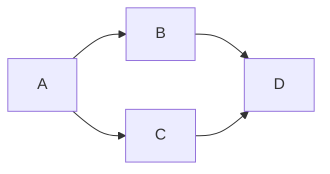
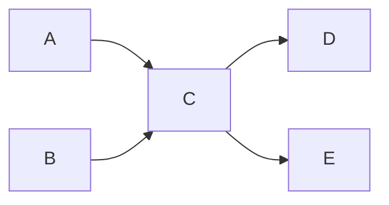
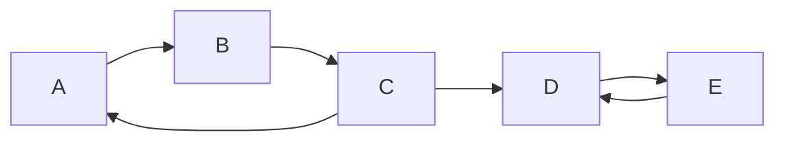

# 03 - Grafet e drejtuara: DAG, Topological Sort dhe SCC

Video përkatëse: [Ligjërata 2](https://www.youtube.com/watch?v=eMq4om7WqJU) dhe [Ushtrimi 2](https://www.youtube.com/watch?v=dBq2LQW2ntY).

## 1. Digraph

Digraph është graf ku brinjët kanë drejtim. Brinja `A -> B` lejon lëvizje nga A te B, por jo automatikisht nga B te A.



Përdorime:

- një link nga një faqe web te një faqe tjetër;
- një person ndjek një person tjetër;
- një detyrë duhet të kryhet para një detyre tjetër;
- një modul varet nga një modul tjetër.

## 2. Indegree dhe outdegree

- `indegree(v)`: numri i brinjëve që hyjnë në `v`;
- `outdegree(v)`: numri i brinjëve që dalin nga `v`.

Në grafin sipër:

- `indegree(A)=0`, `outdegree(A)=2`;
- `indegree(D)=2`, `outdegree(D)=0`.

Një kulm me `indegree=0` nuk varet nga asnjë kulm tjetër. Ky fakt përdoret në topological sort.

## 3. Reprezentimi

Në adjacency list të digraph-it, brinja `v -> w` shtohet vetëm te lista e `v`.

```java
void addEdge(int v, int w) {
    adj[v].add(w);
    E++;
}
```

Mos shto `adj[w].add(v)`, sepse kjo do ta kthente në graf pa drejtim.

## 4. Directed path dhe directed cycle

Rruga duhet t'i respektojë shigjetat.

Nëse kemi `A -> B -> C`, ekziston rrugë nga A te C. Nuk do të thotë se ekziston rrugë nga C te A.

Directed cycle është:

```text
A -> B -> C -> A
```

## 5. DAG

DAG do të thotë **Directed Acyclic Graph**:

- directed: brinjët kanë drejtim;
- acyclic: nuk ka directed cycle.

DAG përdoret për:

- varësi mes lëndëve;
- planifikim detyrash;
- dependencies të programeve;
- shortest/longest path kur grafi nuk ka cikël.

## 6. Zbulimi i ciklit me DFS

Përdoren dy arrays:

- `marked[v]`: a është vizituar ndonjëherë;
- `onStack[v]`: a gjendet aktualisht në rrugën rekursive.

Nëse gjatë DFS hasim brinjë `v -> w` ku `onStack[w] == true`, kemi gjetur directed cycle.

```text
DFS(v):
    marked[v] = true
    onStack[v] = true

    për çdo w në adj[v]:
        nëse kemi cikël: ndalo
        përndryshe nëse w nuk është marked: DFS(w)
        përndryshe nëse onStack[w]: kemi cikël

    onStack[v] = false
```

Pse `marked[]` nuk mjafton? Një brinjë mund të shkojë te një kulm i vizituar në një degë që ka përfunduar. Cikël kemi vetëm kur shkojmë te një kulm ende aktiv në call stack.

## 7. Topological Sort

Topological order është renditje e kulmeve ku për çdo brinjë `u -> v`, `u` shfaqet para `v`.

Shembull:



Dy renditje të sakta:

- `A, B, C, D, E`;
- `B, A, C, E, D`.

Renditja nuk është domosdoshmërisht unike.

### Kushti absolut

Topological order ekziston **nëse dhe vetëm nëse** grafi është DAG.

Në ciklin `A -> B -> C -> A`, topological order do të kërkonte:

- A para B;
- B para C;
- C para A.

Kjo është e pamundur.

## 8. Kahn Algorithm - indegree

Ky version është shumë i përshtatshëm për ekzekutim me dorë.

### Hapat

1. Llogarit `indegree` për çdo kulm.
2. Fut në queue të gjitha kulmet me `indegree=0`.
3. Nxirr një kulm `v` dhe shtoje në output.
4. Për çdo brinjë `v -> w`, zvogëlo `indegree[w]` për 1.
5. Nëse `indegree[w]` bëhet 0, fut `w` në queue.
6. Përsërit derisa queue të zbrazet.

Nëse output-i ka më pak se `V` kulme, grafi ka cikël.

### Shembull

Brinjët:

```text
A->C, B->C, C->D, C->E
```

Indegree fillestar:

| Kulmi | A | B | C | D | E |
|---|---:|---:|---:|---:|---:|
| indegree | 0 | 0 | 2 | 1 | 1 |

| Hapi | Queue para | Del | Ndryshimi | Output |
|---:|---|---|---|---|
| 1 | A, B | A | indegree(C): 2->1 | A |
| 2 | B | B | indegree(C): 1->0; fut C | A, B |
| 3 | C | C | D dhe E bëhen 0 | A, B, C |
| 4 | D, E | D | - | A, B, C, D |
| 5 | E | E | - | A, B, C, D, E |

## 9. Topological sort me DFS

Në një DAG:

1. bëhet DFS;
2. kulmi shtohet në `postorder` vetëm pasi përfundojnë të gjithë fqinjët;
3. `reverse postorder` është topological order.

```text
DFS(v):
    marked[v] = true
    për çdo w në adj[v]:
        nëse w nuk është marked: DFS(w)
    push v në reversePost
```

Ky algoritëm duhet të përdoret vetëm pasi të kontrollohet se nuk ka cikël.

## 10. Strong Connectivity

Në digraph, `v` dhe `w` janë strongly connected nëse:

- ka rrugë nga `v` te `w`;
- ka rrugë nga `w` te `v`.

Strongly Connected Component, SCC, është grup maksimal kulmesh që janë strongly connected mes vete.



SCC-të janë:

- `{A, B, C}`;
- `{D, E}`.

Brinja C->D nuk i bashkon komponentët, sepse nuk ka rrugë nga D/E prapa te A/B/C.

## 11. Reverse graph

Reverse graph `G^R` krijohet duke kthyer çdo brinjë:

```text
Në G:   A -> B
Në G^R: B -> A
```

```java
Digraph reverse() {
    Digraph r = new Digraph(V);
    for (int v = 0; v < V; v++) {
        for (int w : adj(v)) {
            r.addEdge(w, v);
        }
    }
    return r;
}
```

## 12. Kosaraju-Sharir

Algoritmi gjen SCC-të me dy faza DFS.

### Hapat që duhet t'i dish saktë

1. Krijo reverse graph `G^R`.
2. Ekzekuto DFS në `G^R`.
3. Ruaj kulmet në **reverse postorder** të DFS-së së `G^R`.
4. Ekzekuto DFS në grafin origjinal `G`, duke i marrë kulmet sipas atij rendi.
5. Çdo nisje e re e DFS-së në hapin 4 formon një SCC të re.

### Pseudokodi

```text
order = reversePostorder(G.reverse())
count = 0

për çdo v në order:
    nëse v nuk është marked:
        DFS(G, v), duke vendosur id[x] = count
        count++
```

### Pse duhet rendi nga reverse graph?

Ai rend siguron që në grafin origjinal ta fillojmë DFS-in nga një komponent që nuk do të na çojë gabimisht në SCC të papërpunuara. Kjo i izolon komponentët një nga një.

### Condensation graph

Nëse çdo SCC e zëvendësojmë me një kulm të vetëm, marrim condensation graph. Ky graf është gjithmonë DAG.

Nëse condensation graph do të kishte cikël, SCC-të në atë cikël do të arrinin njëra-tjetrën në të dy drejtimet dhe në fakt do të ishin një SCC e vetme.

## 13. Kompleksiteti

- reverse graph: `O(V+E)`;
- DFS në reverse graph: `O(V+E)`;
- DFS në original: `O(V+E)`;
- total: `O(V+E)`.

## 14. Gabimet klasike

1. Të harrohet drejtimi i shigjetës.
2. Të jepet topological order për graf me cikël.
3. Të thuhet se topological order është gjithmonë unik.
4. Të thuhet se rruga `u -> v` automatikisht jep rrugë `v -> u`.
5. Të bëhet Kosaraju pa reverse graph.
6. Të përdoret postorder në vend të reverse postorder.
7. Të bashkohen kulme në SCC vetëm sepse ekziston rrugë në një drejtim.

## Kontrollo veten

1. Çka është DAG?
2. Kur ekziston topological order?
3. Si e zbulon Kahn algorithm një cikël?
4. Çka do të thotë strongly connected?
5. Cili graf përdoret në fazën e parë të Kosaraju?
6. Pse condensation graph nuk ka cikël?

### Përgjigjet

1. Directed Acyclic Graph.
2. Vetëm kur digraph-i është DAG.
3. Në fund përpunohen më pak se V kulme.
4. Ekziston rrugë në të dy drejtimet mes dy kulmeve.
5. Reverse graph `G^R`.
6. Një cikël mes SCC-ve do të nënkuptonte se ato janë një SCC e vetme.

