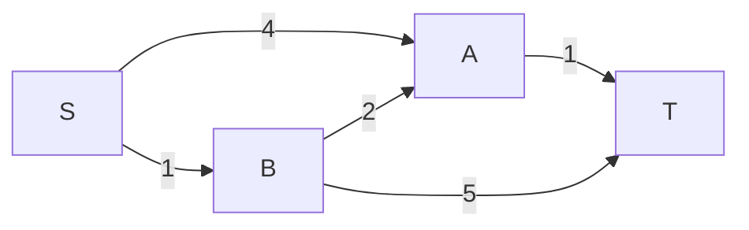

# 05 - Shortest Paths: Relaxation, Dijkstra, Bellman-Ford dhe DAG

Materialet përkatëse janë te Ligjëratat/Ushtrimet 4-5. Fleta në repo e emërtuar `Java 5 - Shortest paths` mbulon Dijkstra, Bellman-Ford dhe Acyclic.

- [Ligjërata 4](https://www.youtube.com/watch?v=w51lmRgpZ_g) / [Ushtrimi 4](https://www.youtube.com/watch?v=sWmTbb1scgY)
- [Ligjërata 5](https://www.youtube.com/watch?v=vi4T5Q_JM7I) / [Ushtrimi 5](https://www.youtube.com/watch?v=lH0iwfn9s2c)

## 1. Problemi

Kemi directed graph me peshë. Duam rrugën me shumën minimale të peshave nga source `s` te kulmet e tjera.



Rrugët nga S te T:

- S->A->T: `4+1=5`;
- S->B->T: `1+5=6`;
- S->B->A->T: `1+2+1=4`.

Shortest path është S->B->A->T me peshë 4.

## 2. Directed edge me peshë

Brinja ka:

- `from`: burimi;
- `to`: destinacioni;
- `weight`: pesha.

```java
class DirectedEdge {
    private final int from;
    private final int to;
    private final double weight;

    DirectedEdge(int from, int to, double weight) {
        this.from = from;
        this.to = to;
        this.weight = weight;
    }

    int from() { return from; }
    int to() { return to; }
    double weight() { return weight; }
}
```

## 3. distTo dhe edgeTo

Për çdo kulm `v`:

- `distTo[v]`: pesha e rrugës më të mirë të njohur nga `s` te `v`;
- `edgeTo[v]`: brinja e fundit në atë rrugë.

Inicializimi:

```text
distTo[s] = 0
distTo[v] = ∞ për çdo v != s
edgeTo[v] = null
```

`∞` do të thotë se ende nuk kemi gjetur rrugë.

## 4. Relaxation

Relaxation është hapi më i rëndësishëm i të gjitha algoritmeve shortest path.

Për brinjën `v -> w` me peshë `weight` kontrollojmë:

```text
A është rruga ekzistuese për w më e shtrenjtë
se rruga deri te v plus brinja v->w?
```

Formula:

```text
nëse distTo[w] > distTo[v] + weight(v,w):
    distTo[w] = distTo[v] + weight(v,w)
    edgeTo[w] = v->w
```

### Shembull

Kemi:

```text
distTo[A] = 4
distTo[B] = 1
brinja B->A ka peshë 2
```

Kontrolli:

```text
4 > 1 + 2
4 > 3   -> po
```

Prandaj:

```text
distTo[A] = 3
edgeTo[A] = B->A
```

## 5. Path reconstruction

Për ta gjetur rrugën te `T`, ndiq `edgeTo` mbrapsht:

```text
edgeTo[T] = A->T
edgeTo[A] = B->A
edgeTo[B] = S->B
```

Mbrapsht: `T <- A <- B <- S`.

Rruga: `S -> B -> A -> T`.

## 6. Dijkstra

Dijkstra funksionon kur **të gjitha peshat janë jo-negative**.

### Ideja

Gjithmonë përpunon kulmin e papërfunduar me `distTo` minimale. Min-priority queue e zgjedh atë kulm.

### Hapat

1. Vendos `distTo[s]=0` dhe të tjerat `∞`.
2. Fute `s` në min-PQ me prioritet 0.
3. Nxirre kulmin `v` me distancën minimale.
4. Relakso çdo brinjë `v->w`.
5. Nëse `distTo[w]` përmirësohet, përditëso prioritetin e `w`.
6. Përsërit derisa PQ të zbrazet.

### Pseudokodi

```text
distTo[s] = 0
pq.insert(s, 0)

derisa pq nuk është bosh:
    v = pq.delMin()

    për çdo edge v->w:
        nëse distTo[w] > distTo[v] + edge.weight:
            distTo[w] = distTo[v] + edge.weight
            edgeTo[w] = edge
            update w në pq
```

### Ekzekutimi i shembullit

| Hapi | Del nga PQ | Relaxations | dist(S,A,B,T) |
|---:|---|---|---|
| 0 | - | inicializimi | 0, ∞, ∞, ∞ |
| 1 | S | S->A=4, S->B=1 | 0, 4, 1, ∞ |
| 2 | B | B->A: 4 bëhet 3; B->T=6 | 0, 3, 1, 6 |
| 3 | A | A->T: 6 bëhet 4 | 0, 3, 1, 4 |
| 4 | T | asnjë | 0, 3, 1, 4 |

### Pse nuk lejohet peshë negative?

Dijkstra e konsideron distancën finale kur kulmi del si minimum nga PQ. Një brinjë negative e zbuluar më vonë mund ta zvogëlojë atë distancë, duke e prishur garancinë.

Shembull:

```text
S->A = 2
S->B = 5
B->A = -10
```

Dijkstra mund ta përfundojë A me 2, por rruga S->B->A ka peshë `5-10=-5`.

Nuk mjafton që grafi të mos ketë negative cycle. Për Dijkstra duhet të mos ketë fare negative edges.

### Kompleksiteti

Me binary heap:

```text
O((V+E) log V)
```

Shpesh shkruhet `O(E log V)` për graf të lidhur.

## 7. Bellman-Ford

Bellman-Ford lejon negative edges. Ai gjithashtu mund të zbulojë negative cycle të arritshëm nga source.

### Pse V-1 kalime?

Një shortest simple path mund të ketë maksimum `V-1` brinjë. Nëse ka më shumë, përsëritet një kulm dhe krijohet cycle.

Pas kalimit të parë, mund të jenë gjetur rrugët me 1 brinjë. Pas të dytit, me deri 2 brinjë. Pas `V-1`, çdo shortest simple path duhet të jetë mbuluar.

### Hapat

1. Inicializo distancat.
2. Përsërit `V-1` herë.
3. Në çdo kalim, relakso të gjitha brinjët.
4. Bëj një kalim shtesë.
5. Nëse ndonjë distancë përmirësohet, ekziston negative cycle i arritshëm.

### Pseudokodi

```text
distTo[s] = 0

për i = 1 deri V-1:
    changed = false

    për çdo edge u->v:
        nëse distTo[v] > distTo[u] + weight:
            përditëso distTo[v] dhe edgeTo[v]
            changed = true

    nëse changed == false:
        ndalo herët
```

### Negative cycle

Negative cycle është cikël me shumë negative.

```text
A->B = 2
B->C = -5
C->A = 1
Shuma = -2
```

Duke e përsëritur ciklin, distanca zvogëlohet pafund. Prandaj shortest path i fundëm nuk ekziston për kulmet që mund të arrihen përmes atij cikli.

### Kompleksiteti

```text
O(VE)
```

Është më i ngadalshëm se Dijkstra, por zgjidh një problem më të përgjithshëm.

## 8. Acyclic Shortest Paths

Në DAG, shortest paths gjenden në `O(V+E)`.

### Hapat

1. Gjej topological order.
2. Inicializo `distTo[s]=0`, të tjerat `∞`.
3. Merr kulmet sipas topological order.
4. Kur merret `v`, relakso të gjitha brinjët dalëse.

```text
order = topologicalSort(G)

për çdo v në order:
    për çdo edge v->w:
        relax(edge)
```

### Pse funksionon?

Kur arrijmë te `v` në topological order, të gjitha brinjët që mund të hyjnë në `v` vijnë nga kulme të përpunuara më herët. Prandaj distanca e tij nuk ka nevojë të rishikohet.

### A lejon pesha negative?

Po. DAG nuk ka cycle, prandaj nuk mund të ketë negative cycle.

### Kompleksiteti

Topological sort `O(V+E)` plus relaxation `O(E)`:

```text
O(V+E)
```

## 9. Longest path në DAG

Në DAG mund të gjendet longest path duke ndryshuar:

- distancat fillestare nga `∞` në `-∞`;
- kontrollin nga `>` në `<`.

Kjo përdoret në scheduling dhe critical path method. Në graf të përgjithshëm longest simple path është problem shumë më i vështirë.

## 10. Cilin algoritëm ta zgjedh?

| Situata | Algoritmi |
|---|---|
| Graf pa peshë | BFS |
| Directed weighted, të gjitha peshat >= 0 | Dijkstra |
| Ka negative edges | Bellman-Ford |
| Grafi është DAG | Acyclic SP |
| Duhet zbulim i negative cycle | Bellman-Ford |

## 11. Gabimet klasike

1. Të përdoret Dijkstra me negative edge.
2. Të harrohet `∞` në inicializim.
3. Të relaksohet `w->v` kur brinja është `v->w`.
4. Të përditësohet `distTo` pa përditësuar `edgeTo`.
5. Të mblidhen vetëm peshat lokale dhe jo `distTo[v]+weight`.
6. Të thuhet se Bellman-Ford bën `V` kalime normale; duhen `V-1`, pastaj kontrolli shtesë.
7. Të përdoret Acyclic SP pa topological order ose në graf me cycle.

## Kontrollo veten

1. Çka është relaxation?
2. Çka ruan `edgeTo[]`?
3. Kur lejohet Dijkstra?
4. Pse Bellman-Ford bën V-1 kalime?
5. Si zbulohet negative cycle?
6. Pse Acyclic SP lejon negative edges?

### Përgjigjet

1. Kontrolli dhe përditësimi i një rruge përmes një brinje.
2. Brinjën e fundit të rrugës më të mirë të njohur.
3. Kur të gjitha peshat janë jo-negative.
4. Sepse një shortest simple path ka maksimum V-1 brinjë.
5. Pas V-1 kalimeve, nëse një kalim tjetër përmirëson distancë.
6. Sepse DAG nuk ka cikle, pra as negative cycle.

