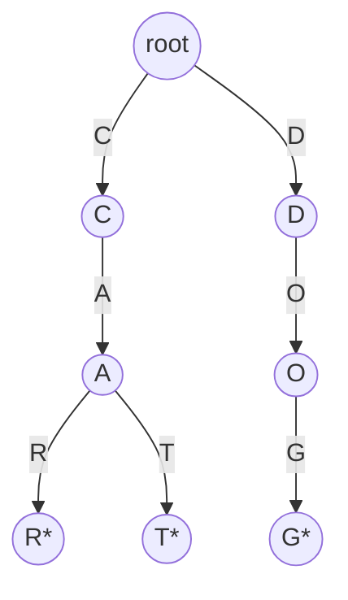

# 07 - Tries dhe Ternary Search Tries

Materiali lidhet me [Ligjëratën 8](https://www.youtube.com/watch?v=4s7zaiAy_nA) dhe [Ushtrimin 8](https://www.youtube.com/watch?v=WqF0ExfKM-w).

## 1. Problemi

Duam symbol table ku keys janë stringje.

Operacionet mund të jenë:

- `put(key, value)`;
- `get(key)`;
- `contains(key)`;
- `delete(key)`;
- `keysWithPrefix(prefix)`;
- `longestPrefixOf(query)`.

Trie e shfrytëzon strukturën e karaktereve dhe prefikset e përbashkëta.

## 2. Çka është prefix?

Prefix është fillimi i stringut.

Për `ALGORITHM`:

```text
"" , A, AL, ALG, ALGO, ..., ALGORITHM
```

`CAR` është prefix i `CARPET`. Nuk do të thotë automatikisht se `CAR` është key e ruajtur. Duhet një shenjë/value në nyjën R.

## 3. R-way Trie

Çdo nyjë ka:

- një `value`, që mund të jetë `null`;
- `R` lidhje, një për secilin karakter.



`*` do të thotë se nyja ka value dhe aty përfundon key.

## 4. Insert - put

Për ta futur `CAT`:

1. Fillo në root me `d=0`.
2. Karakteri `C`; ndiq/krijo lidhjen C.
3. Karakteri `A`; ndiq/krijo lidhjen A.
4. Karakteri `T`; ndiq/krijo lidhjen T.
5. Kur `d == key.length()`, vendos value.

### Pseudokodi rekursiv

```text
put(node x, key, value, d):
    nëse x është null: krijo nyjë

    nëse d == key.length:
        x.value = value
        kthe x

    c = key.charAt(d)
    x.next[c] = put(x.next[c], key, value, d+1)
    kthe x
```

### Java

```java
private Node put(Node x, String key, Object value, int d) {
    if (x == null) x = new Node();

    if (d == key.length()) {
        x.value = value;
        return x;
    }

    char c = key.charAt(d);
    x.next[c] = put(x.next[c], key, value, d + 1);
    return x;
}
```

## 5. Search - get

Për `CAR`:

1. Ndiq C.
2. Ndiq A.
3. Ndiq R.
4. Nëse lidhja mungon, key nuk ekziston.
5. Nëse arrin në fund por `value == null`, stringu është vetëm prefix, jo key.

```text
get(node x, key, d):
    nëse x është null: kthe null
    nëse d == key.length: kthe x

    c = key.charAt(d)
    kthe get(x.next[c], key, d+1)
```

`contains(key)` është `get(key) != null` kur `get` kthen value, ose kontrolli i value të nyjës finale.

## 6. Prefix search

Për `keysWithPrefix("CA")`:

1. Gjej nyjën që përfaqëson `CA`.
2. Nga ajo nyjë bëj DFS në të gjitha lidhjet.
3. Sa herë që has nyjë me value, shto stringun e ndërtuar.

Në shembull kthehen `CAR` dhe `CAT`.

## 7. Longest prefix

`longestPrefixOf(query)` kërkon key-n më të gjatë të ruajtur që është prefix i query.

Keys:

```text
S, SHE, SHELL
```

Query:

```text
SHELLSORT
```

Përgjigjja është `SHELL`.

Gjatë ecjes, sa herë hasim nyjë me value, ruajmë indeksin si kandidatin më të mirë të fundit.

## 8. Delete në R-way Trie

Fshirja ka dy pjesë:

1. hiq value nga nyja ku përfundon key;
2. pastro nyjat që nuk nevojiten më.

Nyja mund të fshihet vetëm nëse:

- `value == null`;
- të gjitha lidhjet e saj janë `null`.

### Shembulli POTTER dhe POTTERHEAD

Nëse ruhen të dyja:

```text
P-O-T-T-E-R* - H-E-A-D*
```

Kur fshihet `POTTER`:

- hiqet `*`/value te R;
- nyja R nuk fshihet, sepse ka lidhjen H që nevojitet për `POTTERHEAD`.

Kur fshihet `POTTERHEAD` pas kësaj:

- hiqet value te D;
- nyjat D,A,E,H mund të pastrohen mbrapsht;
- nëse asnjë key tjetër nuk përdor prefiksin POTTER, pastrohet edhe ajo degë.

### Fshirja e key që nuk ekziston

`delete("KITTEN")` nuk duhet ta ndryshojë Trie-n nëse KITTEN nuk është ruajtur.

### Pseudokodi

```text
delete(x, key, d):
    nëse x është null: kthe null

    nëse d == key.length:
        x.value = null
    përndryshe:
        c = key.charAt(d)
        x.next[c] = delete(x.next[c], key, d+1)

    nëse x.value != null: kthe x
    nëse x ka ndonjë child: kthe x
    kthe null
```

## 9. Kompleksiteti i Trie

Le të jetë `L` gjatësia e key.

- insert: `O(L)`;
- search: `O(L)`;
- delete: `O(L + R*L)` në implementim që kontrollon të gjitha R lidhjet gjatë kthimit; konceptualisht puna varet nga gjatësia dhe kontrolli i children;
- prefix search: `O(L + numri i karaktereve në rezultat)`.

Avantazhi: koha nuk varet drejtpërdrejt nga numri total i keys.

Mangësia: çdo nyjë ka `R` lidhje, shpesh shumica `null`, prandaj përdoret shumë memorie.

## 10. TST - Ternary Search Trie

Çdo nyjë TST ruan:

- një karakter `c`;
- `left` për karakter më të vogël;
- `mid` për karakter të barabartë;
- `right` për karakter më të madh;
- `value` nëse key përfundon aty.

```text
if currentChar < x.c: shko left, d nuk ndryshon
if currentChar > x.c: shko right, d nuk ndryshon
if currentChar == x.c: shko mid dhe d++
```

Ky detaj është shumë i rëndësishëm: indeksi i stringut rritet vetëm kur karakteri është i barabartë.

## 11. Insert në TST

```text
put(x, key, value, d):
    c = key.charAt(d)
    nëse x është null: x = node(c)

    nëse c < x.c:
        x.left = put(x.left, key, value, d)
    përndryshe nëse c > x.c:
        x.right = put(x.right, key, value, d)
    përndryshe nëse d < key.length-1:
        x.mid = put(x.mid, key, value, d+1)
    përndryshe:
        x.value = value

    kthe x
```

## 12. Search në TST

```text
x = root
d = 0

derisa x != null:
    c = key.charAt(d)

    nëse c < x.c: x = x.left
    përndryshe nëse c > x.c: x = x.right
    përndryshe nëse d < key.length-1:
        d++
        x = x.mid
    përndryshe:
        kthe x

kthe null
```

## 13. Trie kundrejt TST

| R-way Trie | TST |
|---|---|
| Çdo nyjë ka R lidhje | Çdo nyjë ka 3 lidhje |
| Kërkim direkt sipas karakterit | Mund të bëjë disa krahasime left/right |
| Shumë i shpejtë | Kursen shumë memorie |
| Shumë lidhje null | Forma varet nga rendi i insertimit |

## 14. Gabimet klasike

1. Të mendohet se çdo prefix është key.
2. Të fshihet e gjithë dega kur fshihet një key që është prefix i një tjetri.
3. Të harrohet value/shenja e fundit të key.
4. Në TST, të rritet `d` kur shkohet left ose right.
5. Të thuhet se TST ka R lidhje për nyjë.
6. Të vazhdohet search edhe kur lidhja e kërkuar është null.

## Kontrollo veten

1. Si dallon key i plotë nga prefix i zakonshëm?
2. Sa lidhje ka një nyjë në R-way Trie?
3. Sa lidhje ka një nyjë në TST?
4. Kur rritet `d` në TST?
5. Çka ndodh kur fshihet POTTER por ekziston POTTERHEAD?
6. Cili është kompleksiteti i search sipas gjatësisë L?

### Përgjigjet

1. Nyja finale ka value/shenjë fundi.
2. R.
3. Tri: left, mid, right.
4. Vetëm kur karakteri është i barabartë dhe shkohet mid.
5. Hiqet value e POTTER, por dega ruhet për POTTERHEAD.
6. O(L), duke e trajtuar alfabetin/strukturën si të përshtatshme.

