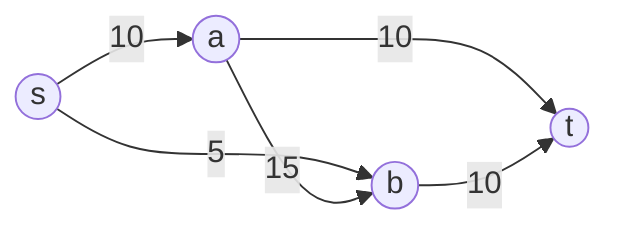

# 11 - Maximum Flow, Residual Graph dhe Ford-Fulkerson

Video përkatëse: [Ligjërata 12](https://www.youtube.com/watch?v=FIwWQf8gyYM) dhe [Ushtrimi 12](https://www.youtube.com/watch?v=20X0K2TOomE).

## 1. Problemi

Kemi directed network me:

- source `s`, ku fillon flow;
- sink `t`, ku përfundon flow;
- capacity `c(e)` për çdo brinjë;
- flow `f(e)` që aktualisht kalon në brinjë.

Shembuj praktikë:

- të dhëna në rrjet;
- trafik në rrugë;
- ujë në gypa;
- matching mes dy grupeve;
- image segmentation.



Numrat janë capacities.

## 2. Capacity constraint

Flow në brinjë nuk mund të jetë negativ dhe nuk mund ta kalojë kapacitetin:

```text
0 <= f(e) <= c(e)
```

Nëse brinja ka capacity 10, flow mund të jetë 0, 3, 10, por jo 12.

## 3. Flow conservation - ekuilibri lokal

Për çdo kulm `v` përveç `s` dhe `t`:

```text
flow që hyn në v = flow që del nga v
```

Nëse në A hyjnë 8 njësi, nga A duhet të dalin gjithsej 8.

Ky është kuptimi i kulmit në **ekuilibër lokal**.

Source dhe sink nuk i nënshtrohen kësaj barazie:

- source prodhon net flow;
- sink pranon net flow.

## 4. Vlera e flow

Vlera e flow është:

```text
shuma e flow që del nga s - flow që hyn në s
```

Në rrjete standarde pa brinjë që hyjnë në s, është thjesht shuma që del nga s.

E njëjta vlerë duhet të arrijë në t.

## 5. Residual capacity

Residual graph tregon çka mund të ndryshojmë në flow-in aktual.

Për brinjën `u->v` me capacity `c` dhe flow `f`:

### Forward residual capacity

Sa flow shtesë mund të dërgojmë:

```text
c_f(u,v) = c(u,v) - f(u,v)
```

Nëse capacity është 10 dhe flow 6, forward residual është 4.

### Backward residual capacity

Sa flow të mëhershëm mund ta anulojmë:

```text
c_f(v,u) = f(u,v)
```

Në të njëjtin shembull, backward residual është 6.

## 6. Pse duhet backward edge?

Ford-Fulkerson mund të zgjedhë një augmenting path që më vonë del jo i mirë. Backward edge lejon anulimin e një pjese të flow-it dhe ridrejtimin përmes rrugës tjetër.

Pa backward edges, rezultati mund të varet nga zgjedhja e parë dhe algoritmi mund të ngecë para optimumit.

Backward edge nuk është domosdoshmërisht brinjë reale e rrjetit. Është mundësi në residual graph për të zvogëluar flow-in ekzistues.

## 7. Augmenting path

Augmenting path është rrugë nga `s` te `t` në residual graph ku çdo brinjë ka residual capacity pozitive.

### Bottleneck

Bottleneck është residual capacity minimale në rrugë.

Rrugë:

```text
s -> A -> B -> t
Residual capacities: 8, 3, 7
```

Bottleneck është 3. Mund të shtojmë maksimum 3 njësi përgjatë kësaj rruge.

## 8. Augmentation

Për çdo brinjë në augmenting path:

- nëse përdoret forward edge, rrit flow për bottleneck;
- nëse përdoret backward edge, zvogëlo flow për bottleneck.

Pas ndryshimit, residual capacities përditësohen.

## 9. Ford-Fulkerson

### Hapat

1. Fillo me flow 0.
2. Ndërto/kupto residual graph.
3. Gjej augmenting path nga `s` te `t`.
4. Gjej bottleneck-un e path-it.
5. Augmento flow-in me bottleneck.
6. Përsërit derisa nuk ka augmenting path.

### Pseudokodi

```text
flow = 0

derisa ekziston augmenting path P nga s te t:
    bottle = ∞

    për çdo residual edge e në P:
        bottle = min(bottle, residualCapacity(e))

    për çdo edge e në P:
        addResidualFlowTo(e, bottle)

    flow += bottle
```

## 10. Si gjendet augmenting path?

Mund të përdoret DFS ose BFS në residual graph, duke ndjekur vetëm brinjë me residual capacity > 0.

Kur përdoret BFS, varianti quhet Edmonds-Karp. Ai zgjedh path me numrin më të vogël të brinjëve dhe ka garanci polinomiale.

Arrays tipike:

- `marked[v]`: a arrihet v në residual graph;
- `edgeTo[v]`: brinja residuale me të cilën u arrit v.

## 11. Shembull hap pas hapi

Rrjeti:

```text
s->a 10
s->b 5
a->b 15
a->t 10
b->t 10
```

### Fillimi

Të gjitha flows janë 0.

### Path 1

```text
s->a->t
Residuals: 10, 10
Bottleneck: 10
```

Pas augmentimit:

```text
f(s,a)=10
f(a,t)=10
Vlera e flow=10
```

### Path 2

```text
s->b->t
Residuals: 5, 10
Bottleneck: 5
```

Pas augmentimit:

```text
f(s,b)=5
f(b,t)=5
Vlera e flow=15
```

Nuk ka më residual path nga s, sepse të dy brinjët dalëse nga s janë saturated.

Max flow është 15.

## 12. Saturated edge

Brinja është saturated kur:

```text
f(e) = c(e)
```

Forward residual capacity i saj është 0. Ende mund të ekzistojë backward residual capacity.

## 13. s-t cut

Cut e ndan kulmet në dy grupe:

- grupi S përmban source `s`;
- grupi T përmban sink `t`.

Capacity e cut-it është shuma e capacities të brinjëve që shkojnë nga grupi S te grupi T.

Brinjët nga T prapa në S nuk numërohen në capacity të directed cut.

## 14. Max-Flow Min-Cut Theorem

```text
vlera e maximum flow = capacity e minimum s-t cut
```

Kur Ford-Fulkerson përfundon:

1. Në residual graph gjej kulmet që arrihen nga s. Ato formojnë grupin S.
2. Kulmet e paarritshme formojnë grupin T.
3. Brinjët origjinale nga S te T janë saturated.
4. Capacity e atij cut-i është e barabartë me flow-in.

Kjo jo vetëm jep përgjigjen, por edhe provon se flow është maksimal.

## 15. Shembulli S-A-B-C-D-E-F-G-T nga fleta

Kapacitetet e rëndësishme të cut-it:

```text
S->A = 6
S->B = 1
C->B = 2
F->T = 4
```

Cut-i me anën e source `X={S,C,F}` ka capacity:

```text
6 + 1 + 2 + 4 = 13
```

Ekziston flow i realizueshëm me vlerë 13, për shembull:

```text
S->A = 6
S->B = 1
S->C = 6

A->D = 4
A->B = 2
C->B = 2
C->F = 4
B->E = 5
D->G = 4
E->G = 5
F->T = 4
G->T = 9
```

Kontrolli i conservation:

- A: hyn 6, dalin 4+2=6;
- B: hyjnë 1+2+2=5, dalin 5;
- C: hyn 6, dalin 2+4=6;
- D: hyn 4, del 4;
- E: hyn 5, del 5;
- F: hyn 4, del 4;
- G: hyjnë 4+5=9, dalin 9.

Flow ka vlerë 13 dhe ekziston cut me capacity 13. Sipas max-flow min-cut, maksimumi është 13.

## 16. Integrality

Nëse capacities janë integers, Ford-Fulkerson mund të prodhojë maximum flow me vlera integer, kur augmentimet bëhen me bottleneck integer.

Kjo është e dobishme për probleme ku flow përfaqëson objekte të pandashme, p.sh. matching.

## 17. Kompleksiteti

Ford-Fulkerson me capacities integer:

```text
O(E * maxFlow)
```

sepse çdo augmentim rrit flow të paktën me 1 dhe gjetja e path-it kërkon `O(E)`.

Edmonds-Karp, që përdor BFS:

```text
O(VE²)
```

## 18. Gabimet klasike

1. Të tejkalohet capacity.
2. Të prishet conservation në kulm të ndërmjetëm.
3. Të llogaritet bottleneck si maksimum në vend të minimumit.
4. Të harrohen backward residual edges.
5. Të llogariten brinjët T->S në capacity të cut-it.
6. Të ndalet algoritmi sepse path-i i parë u saturua; duhet kontrolluar nëse ekziston path tjetër.
7. Të jepet vetëm vlera pa flows dhe pa kontrollin e kulmeve.

## Kontrollo veten

1. Cilat janë dy kufizimet e flow?
2. Çka është ekuilibri lokal?
3. Si llogaritet forward residual capacity?
4. Si llogaritet backward residual capacity?
5. Çka është bottleneck?
6. Kur përfundon Ford-Fulkerson?
7. Çka thotë max-flow min-cut theorem?

### Përgjigjet

1. Capacity constraint dhe flow conservation.
2. Hyrja totale është e barabartë me daljen totale në kulm të ndërmjetëm.
3. `capacity-flow`.
4. Është e barabartë me flow-in aktual që mund të anulohet.
5. Residual capacity minimale në augmenting path.
6. Kur nuk ekziston augmenting path nga s te t.
7. Maximum flow ka vlerë të barabartë me capacity e minimum cut.

